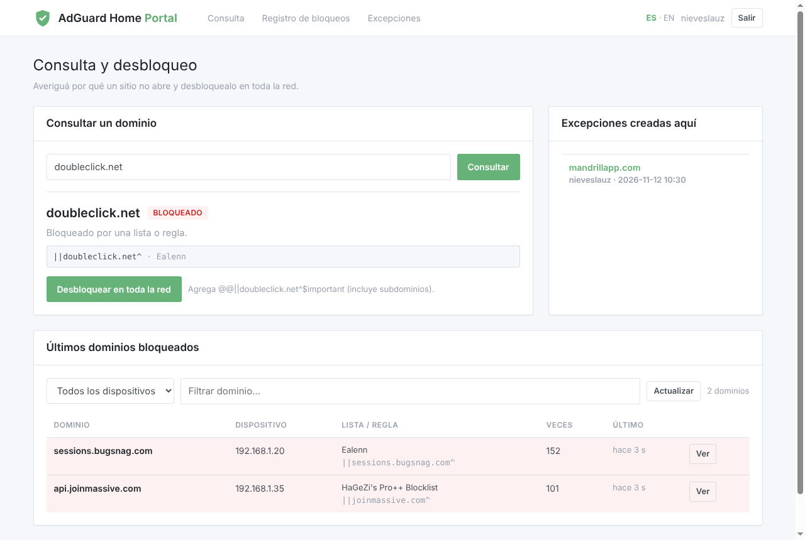
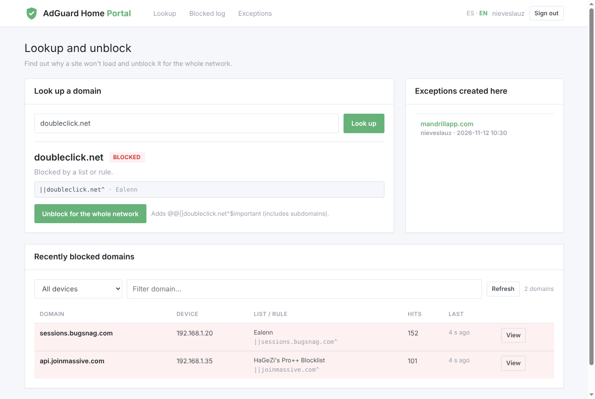
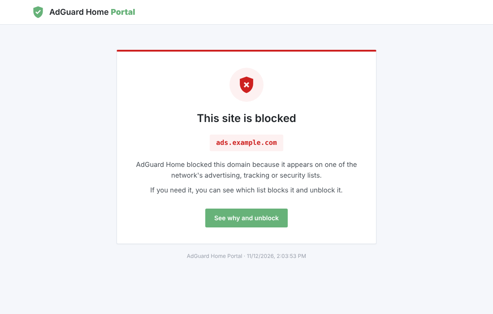

# AdGuard Home Portal

**Español** · [English](#english)

Portal web para [AdGuard Home](https://github.com/AdguardTeam/AdGuardHome), con su misma línea visual (modo claro y oscuro automático). La interfaz está en español e inglés: toma el idioma del navegador y tiene un selector ES/EN.

Desarrollado por [Zigma](https://zigma.com.uy).

> Proyecto independiente. No está afiliado a AdGuard ni cuenta con su respaldo.




## Qué resuelve

1. **«¿Por qué no abre este sitio?»** Escribís un dominio (o pegás un enlace) y el portal muestra qué lista y qué regla lo bloquean. Con un botón lo **desbloqueás en toda la red**. También lista **los últimos dominios bloqueados por dispositivo** (IP), leyendo el registro de una o varias instancias.
2. **Una página de bloqueo clara.** En lugar de «no se encuentra el sitio», AdGuard responde con la IP del portal y el navegador muestra un aviso con el dominio y un botón para ir a desbloquearlo.

## Cómo funciona

- **`app`** (Flask):
  - consulta `/control/filtering/check_host` y lee `/control/querylog`;
  - agrega excepciones `@@||dominio^$important` a las reglas personalizadas de la instancia principal, con un comentario `! [adguard-home-portal] dominio — usuario — fecha`;
  - solo quita las excepciones que creó el propio portal; el resto de tus reglas no se toca.
- **`blockpage`** (nginx): responde a *cualquier* dominio en los puertos 80 y 443. A los navegadores les muestra la página; a rastreadores y recursos les devuelve un `204` vacío, para no generar carga.
- **Acceso:** usuario y contraseña, OIDC (PocketID, Authentik, Keycloak…) o ambos. Las acciones que cambian reglas llevan token CSRF y los intentos de inicio de sesión fallidos se limitan.

Si usás [adguardhome-sync](https://github.com/bakito/adguardhome-sync), apuntá el portal a la instancia de origen: las excepciones llegan solas a las réplicas.

## Limitación importante: HTTPS

Casi todos los sitios usan HTTPS, y nadie puede presentar un certificado válido para un dominio ajeno.

- **Sitios HTTPS:** el navegador muestra primero una **advertencia de certificado** (emitido a «Sitio bloqueado por AdGuard Home»). Esa advertencia ya indica que el DNS bloqueó el dominio; si se continúa, se ve la página.
- **Sitios HTTP:** la página aparece directamente.
- **Apps (TV, móviles):** solo ven un error de conexión, como antes.

## Instalación

```bash
git clone https://github.com/christiannieveslauz/adguard-home-portal.git
cd adguard-home-portal
cp .env.example .env && chmod 600 .env   # completar
docker compose up -d --build
```

Los puertos 80 y 443 del equipo tienen que estar libres: los usa la página de bloqueo. El portal queda en `APP_PORT` (8090 por defecto). Publicalo detrás de tu proxy inverso con HTTPS y poné esa dirección en `ADMIN_URL`.

### Usuario de AdGuard

El portal usa la API de AdGuard Home con un usuario de la instancia (sección `users:` de `AdGuardHome.yaml`). Ese usuario tiene acceso completo, así que protegé el `.env`.

### Activar la página de bloqueo

En *Configuración → Configuración DNS → Modo de bloqueo*, elegí **IP personalizada**:
- **IPv4:** la IP del equipo donde corre `blockpage`.
- **IPv6:** `::`.

Para volver atrás, elegí *Predeterminado*.

### OIDC (PocketID)

1. Creá un cliente con la URL de retorno `https://TU-ADMIN-URL/auth/callback`.
2. El cliente puede ser público con PKCE: en ese caso, dejá `OIDC_CLIENT_SECRET` vacío.
3. Para limitar el acceso a ciertos usuarios, usá `OIDC_ALLOWED_USERS`.

---

<a id="english"></a>
# AdGuard Home Portal (English)

A web portal for [AdGuard Home](https://github.com/AdguardTeam/AdGuardHome) that matches its look and feel (automatic light and dark mode). The interface is available in Spanish and English: it follows the browser language and has an ES/EN switch.

Built by [Zigma](https://zigma.com.uy).

> Independent project. Not affiliated with or endorsed by AdGuard.





## What it solves

1. **"Why won't this site load?"** Type a domain (or paste a link) and the portal shows which list and which rule block it. One click **unblocks it for the whole network**. It also lists **recently blocked domains per device** (IP), reading the query log of one or more instances.
2. **A clear block page.** Instead of "site can't be reached", AdGuard answers with the portal's IP and the browser shows a notice with the domain and a button to go unblock it.

## How it works

- **`app`** (Flask):
  - calls `/control/filtering/check_host` and reads `/control/querylog`;
  - adds `@@||domain^$important` exceptions to the primary instance's custom rules, with a `! [adguard-home-portal] domain — user — date` comment;
  - only removes the exceptions it created itself; the rest of your rules are never touched.
- **`blockpage`** (nginx): answers *any* domain on ports 80 and 443. Browsers get the page; trackers and resources get an empty `204`, so it adds almost no load.
- **Access:** username and password, OIDC (PocketID, Authentik, Keycloak…) or both. Actions that change rules require a CSRF token, and failed sign-ins are rate-limited.

If you use [adguardhome-sync](https://github.com/bakito/adguardhome-sync), point the portal at the origin instance: exceptions reach the replicas automatically.

## Important limitation: HTTPS

Almost every site uses HTTPS, and nobody can present a valid certificate for a domain they don't own.

- **HTTPS sites:** the browser first shows a **certificate warning** (issued to "Sitio bloqueado por AdGuard Home"). The warning itself tells you the domain was blocked by DNS; if you proceed, you see the page.
- **HTTP sites:** the page shows up directly.
- **Apps (TVs, phones):** they just get a connection error, as before.

## Installation

```bash
git clone https://github.com/christiannieveslauz/adguard-home-portal.git
cd adguard-home-portal
cp .env.example .env && chmod 600 .env   # fill it in
docker compose up -d --build
```

Ports 80 and 443 on the host must be free: the block page uses them. The portal listens on `APP_PORT` (8090 by default). Publish it behind your reverse proxy with HTTPS and put that address in `ADMIN_URL`. Set `DEFAULT_LANG=en` to fall back to English when the browser language is neither Spanish nor English.

### AdGuard user

The portal uses the AdGuard Home API with one of the instance's users (`users:` section of `AdGuardHome.yaml`). That user has full access, so keep `.env` private.

### Enabling the block page

In *Settings → DNS settings → Blocking mode*, choose **Custom IP**:
- **IPv4:** the IP of the host running `blockpage`.
- **IPv6:** `::`.

To revert, choose *Default*.

### OIDC (PocketID)

1. Create a client with the redirect URL `https://YOUR-ADMIN-URL/auth/callback`.
2. It can be a public client with PKCE: in that case, leave `OIDC_CLIENT_SECRET` empty.
3. To restrict access to certain users, use `OIDC_ALLOWED_USERS`.

---

## Licencia / License

MIT © 2026 [Zigma](https://zigma.com.uy)
